# Práctica 02: Red de Adopción de Mascotas con Neo4j

**Autor:** Diego Cancho González
**Escenario Elegido:** 4. Red de adopción de mascotas.

## 1. Definición del Problema y Contexto (Actividad 1)

El abandono animal y la saturación de las protectoras es un desafío crítico. Encontrar el hogar ideal para un animal rescatado no es una simple transacción; requiere cruzar múltiples variables complejas: el comportamiento del animal, sus necesidades de espacio, su historial clínico y su compatibilidad con otros animales, frente a las condiciones de vida, ubicación y núcleo familiar del posible adoptante. 

En bases de datos relacionales tradicionales, este nivel de cruce de datos requiere consultas pesadas con múltiples `JOINs`, penalizando el rendimiento. Mediante el uso de **Neo4j y bases de datos de grafos**, este proyecto modela estas interacciones como una red de nodos interconectados. Esto permite recorrer millones de conexiones en milisegundos, habilitando un motor de recomendación en tiempo real que asegura la asignación más compatible, reduciendo así la tasa de devoluciones y mejorando el bienestar animal.

### 1.1. Actores Principales del Sistema

El ecosistema de esta red está compuesto por los siguientes actores y entidades, cada uno con un rol específico dentro del grafo:

1. **Animal Rescatado:** Es el nodo central del modelo. Posee características físicas (tamaño, especie, edad) y de comportamiento (necesidad de espacio exterior, sociabilidad, reactividad). 
2. **Protectora:** Entidad jurídica y física que realiza el rescate, asume la tutela legal del animal y gestiona los recursos iniciales.
3. **Casa de Acogida:** Voluntarios que ofrecen sus hogares temporalmente para liberar espacio en las protectoras, proporcionando un entorno seguro para la recuperación o socialización del animal.
4. **Adoptante:** Usuario final registrado en la plataforma que busca integrar un animal en su familia. Su perfil está definido por sus recursos espaciales (ciudad, tipo de vivienda, disponibilidad de jardín) y su entorno actual (si convive o no con otros animales).
5. **Motor de Recomendación:** Representa la lógica de negocio apoyada en Cypher. Es el actor no humano que evalúa constantemente los patrones del grafo para sugerir emparejamientos de alta idoneidad.

### 1.2. Preguntas de Negocio (Casos de Uso)

El diseño de la base de datos está orientado a responder de manera inmediata a las siguientes preguntas clave de negocio:

1. **¿Qué animales de tamaño grande están actualmente en protectoras o casas de acogida en una ciudad específica?**
   * *Objetivo:* Optimizar la logística de transporte y liberar rápidamente cheniles (jaulas) grandes en zonas saturadas.
2. **¿Qué adoptantes tienen jardín y no tienen otras mascotas en la actualidad?**
   * *Objetivo:* Encontrar candidatos "unicornio", ideales para acoger perros con problemas de reactividad o alta energía que requieren exclusividad y espacio.
3. **¿Qué animales son compatibles con gatos y están listos para adopción?**
   * *Objetivo:* Minimizar los conflictos territoriales y devoluciones en hogares multiespecie.
4. **¿Cuál es el camino de conexión (trazabilidad) entre un adoptante, su nueva mascota y la protectora de origen?**
   * *Objetivo:* Mantener un historial completo para auditorías, seguimientos post-adopción y control legal de la cadena de custodia del animal.
5. **¿Qué casas de acogida tienen disponibilidad en la misma ciudad que la protectora?**
   * *Objetivo:* Agilizar traslados de emergencia cuando una protectora supera su aforo máximo, minimizando el estrés del viaje para el animal.
6. **Recomendación de afinidad (Match 100%): ¿Qué animales encajan de forma perfecta con el perfil de un adoptante específico basándose en espacio, ciudad y convivencia previa?**
   * *Objetivo:* Es el núcleo de la aplicación; generar un *feed* de recomendaciones personalizadas para los adoptantes, aumentando drásticamente la probabilidad de éxito de la adopción.

### 1.3. Naturaleza de los Datos (Lecturas vs Escrituras)

El sistema presenta una carga de trabajo asimétrica, típica de las plataformas de recomendación:

- **Lecturas masivas (Tiempo real):** Constituyen el **90% de las operaciones**. Los usuarios navegan por la app filtrando por ciudad o características, y el motor de recomendación escanea constantemente el grafo buscando patrones de afinidad, calculando distancias y compatibilidades. Estas consultas deben ejecutarse en milisegundos.
- **Escrituras (Puntuales):** Representan el **10% de las operaciones**. Incluyen el registro de nuevos usuarios, la ingesta de datos de un nuevo animal rescatado o la creación de una relación de adopción `[:ADOPTA]`. Son operaciones controladas que mutan el estado del grafo pero con menor frecuencia que las lecturas.

### 1.4. Requisitos de Seguridad, Privacidad (RGPD) y Crecimiento

- **Privacidad de los datos (RGPD):** Dado que se manejan datos de personas físicas (Adoptantes y Casas de Acogida), el diseño del grafo aplica principios de *minimización de datos*. Los nombres reales, teléfonos o direcciones exactas no se almacenan como texto plano en los nodos. Se utilizan identificadores únicos (`id` alfanuméricos) y alias (pseudonimización). Si el sistema requiriese esos datos para logística, se alojarían en una base de datos relacional segura externa, actuando el grafo únicamente como motor analítico de conexiones.
- **Seguridad y Disponibilidad:** Se requiere implementar control de acceso basado en roles (RBAC). Los usuarios de la app móvil (adoptantes) tendrán permisos estrictos de solo lectura (`READ`) sobre partes específicas del grafo, mientras que el personal de las protectoras tendrá permisos de escritura (`WRITE`) limitados a los animales bajo su tutela.
- **Previsión de crecimiento:** El modelo está diseñado para escalar a nivel nacional. Al extraer etiquetas como `:Ciudad` o `:Especie` a nodos independientes, se previene la redundancia de datos. No obstante, se han diseñado estrategias de índices secundarios para evitar el problema de "súper nodos" a medida que la red integre cientos de protectoras y miles de usuarios.

# Diseño del Grafo (Actividad 2)

## Diagrama del Modelo (Mermaid)

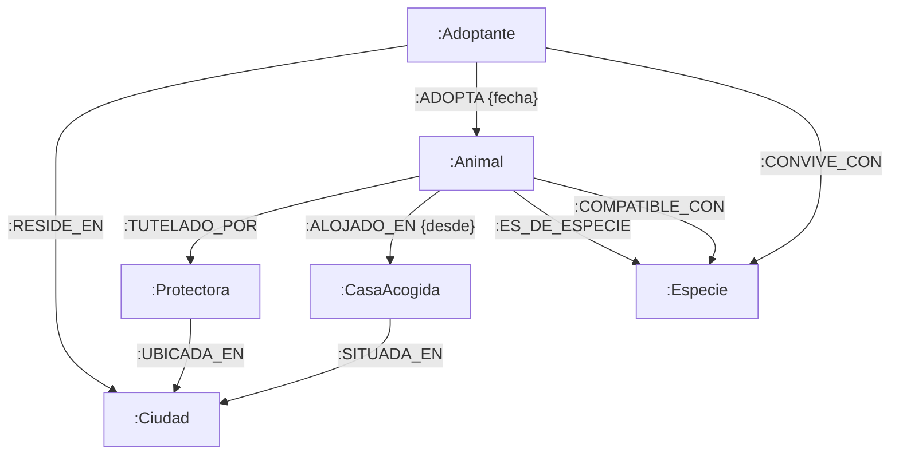

## 3. Implementar restricciones, índices y carga de datos
### scripts/01-restricciones-indices.cypher

```cypher
// 1. Restricciones de unicidad (Evita duplicados y crea un índice B-Tree automático)
CREATE CONSTRAINT animal_id IF NOT EXISTS FOR (a:Animal) REQUIRE a.id IS UNIQUE;
CREATE CONSTRAINT adoptante_id IF NOT EXISTS FOR (ad:Adoptante) REQUIRE ad.id IS UNIQUE;
CREATE CONSTRAINT protectora_id IF NOT EXISTS FOR (p:Protectora) REQUIRE p.id IS UNIQUE;
CREATE CONSTRAINT acogida_id IF NOT EXISTS FOR (ca:CasaAcogida) REQUIRE ca.id IS UNIQUE;
CREATE CONSTRAINT ciudad_id IF NOT EXISTS FOR (c:Ciudad) REQUIRE c.id IS UNIQUE;
CREATE CONSTRAINT especie_id IF NOT EXISTS FOR (e:Especie) REQUIRE e.id IS UNIQUE;

// 2. Índices secundarios (Para acelerar búsquedas de atributos comunes sin escanear el grafo)
CREATE INDEX animal_tamano IF NOT EXISTS FOR (a:Animal) ON (a.tamano);
CREATE INDEX adoptante_jardin IF NOT EXISTS FOR (ad:Adoptante) ON (ad.tiene_jardin);
```

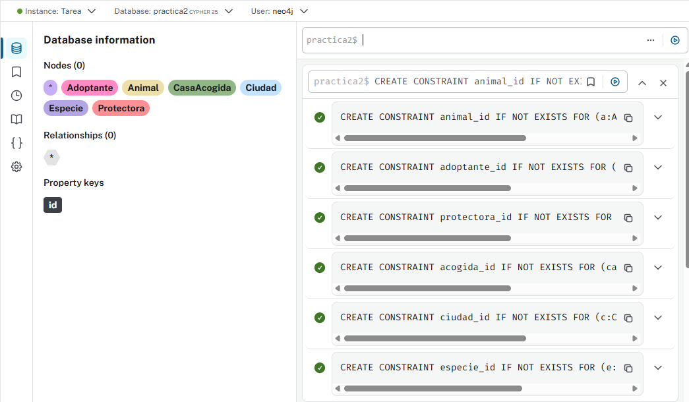
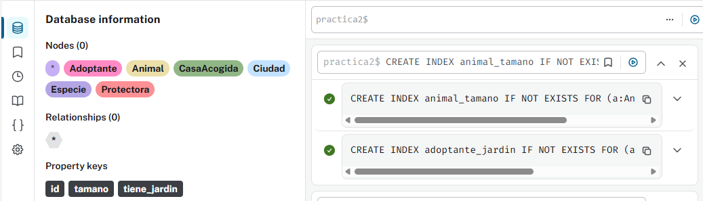

## 4. Resolver consultas Cypher y caminos complejos
### scripts/02-carga-datos.cypher

```cypher
// 3. Carga controlada y segura (Idempotente) utilizando MERGE
// Creación de Ciudades y Especies (Catálogos)
MERGE (c1:Ciudad {id: "MAD"}) SET c1.nombre = "Madrid"
MERGE (c2:Ciudad {id: "BCN"}) SET c2.nombre = "Barcelona"
MERGE (e1:Especie {id: "PER"}) SET e1.nombre = "Perro"
MERGE (e2:Especie {id: "GAT"}) SET e2.nombre = "Gato"

// Creación de Protectoras y Casas de Acogida
MERGE (p1:Protectora {id: "P1"}) SET p1.nombre = "Refugio Patas"
MERGE (p2:Protectora {id: "P2"}) SET p2.nombre = "Gatos Sin Hogar BCN"
MERGE (ca1:CasaAcogida {id: "CA1"}) SET ca1.alias = "Familia Pérez", ca1.capacidad_maxima = 2
MERGE (ca2:CasaAcogida {id: "CA2"}) SET ca2.alias = "Laura Voluntaria", ca2.capacidad_maxima = 1

// Creación de Animales
MERGE (a1:Animal {id: "A1"}) SET a1.nombre = "Toby", a1.tamano = "Grande", a1.necesita_jardin = true
MERGE (a2:Animal {id: "A2"}) SET a2.nombre = "Luna", a2.tamano = "Pequeño", a2.necesita_jardin = false
MERGE (a3:Animal {id: "A3"}) SET a3.nombre = "Simba", a3.tamano = "Mediano", a3.necesita_jardin = false
MERGE (a4:Animal {id: "A4"}) SET a4.nombre = "Rex", a4.tamano = "Grande", a4.necesita_jardin = true
MERGE (a5:Animal {id: "A5"}) SET a5.nombre = "Mia", a5.tamano = "Pequeño", a5.necesita_jardin = false

// Creación de Adoptantes
MERGE (ad1:Adoptante {id: "AD1"}) SET ad1.alias = "Usuario_A88", ad1.tiene_jardin = true
MERGE (ad2:Adoptante {id: "AD2"}) SET ad2.alias = "Usuario_B42", ad2.tiene_jardin = false
MERGE (ad3:Adoptante {id: "AD3"}) SET ad3.alias = "Usuario_C11", ad3.tiene_jardin = false

// Relaciones: Ubicaciones
MERGE (p1)-[:UBICADA_EN]->(c1)
MERGE (p2)-[:UBICADA_EN]->(c2)
MERGE (ca1)-[:SITUADA_EN]->(c1)
MERGE (ca2)-[:SITUADA_EN]->(c2)
MERGE (ad1)-[:RESIDE_EN]->(c1)
MERGE (ad2)-[:RESIDE_EN]->(c1)
MERGE (ad3)-[:RESIDE_EN]->(c2)

// Relaciones: Especies y Compatibilidad
MERGE (a1)-[:ES_DE_ESPECIE]->(e1)
MERGE (a2)-[:ES_DE_ESPECIE]->(e1)
MERGE (a3)-[:ES_DE_ESPECIE]->(e2)
MERGE (a4)-[:ES_DE_ESPECIE]->(e1)
MERGE (a5)-[:ES_DE_ESPECIE]->(e2)

MERGE (a1)-[:COMPATIBLE_CON]->(e2) // Toby se lleva bien con gatos
MERGE (a2)-[:COMPATIBLE_CON]->(e1) // Luna se lleva bien con otros perros
MERGE (a5)-[:COMPATIBLE_CON]->(e2)

// Relaciones: Tutela y Alojamiento
MERGE (a1)-[:TUTELADO_POR]->(p1)
MERGE (a2)-[:TUTELADO_POR]->(p1)
MERGE (a3)-[:TUTELADO_POR]->(p2)
MERGE (a4)-[:TUTELADO_POR]->(p1)
MERGE (a5)-[:TUTELADO_POR]->(p2)

MERGE (a1)-[:ALOJADO_EN {desde: "2023-01-15"}]->(ca1)
MERGE (a3)-[:ALOJADO_EN {desde: "2023-05-10"}]->(ca2)

// Relaciones: Adopciones y Convivencia de adoptantes
MERGE (ad2)-[:CONVIVE_CON]->(e2) // AD2 ya tiene un gato
MERGE (ad1)-[:ADOPTA {fecha: "2023-10-01"}]->(a4) // Rex fue adoptado por AD1
```

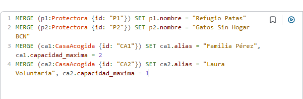
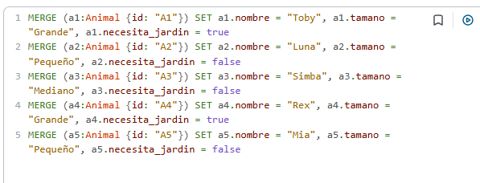
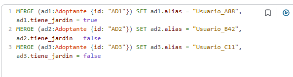
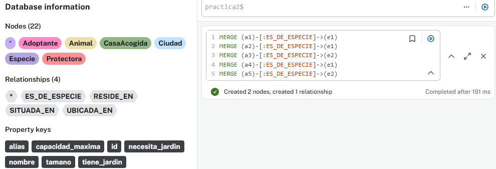
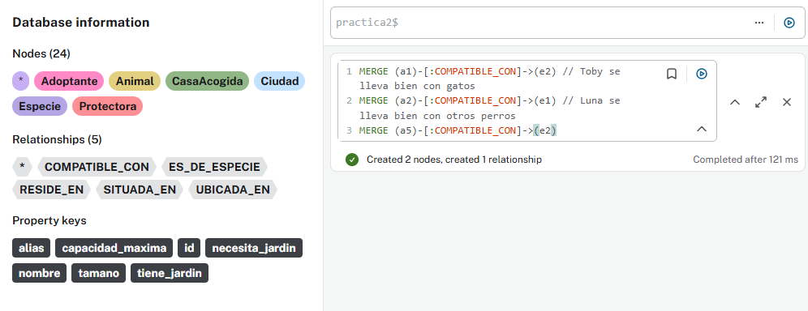
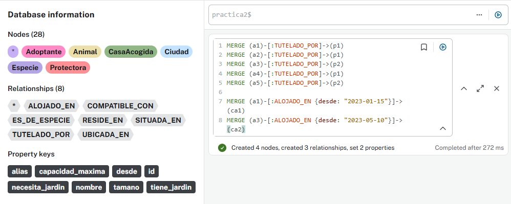
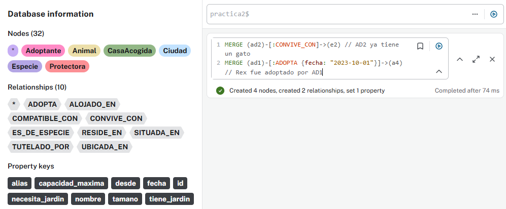
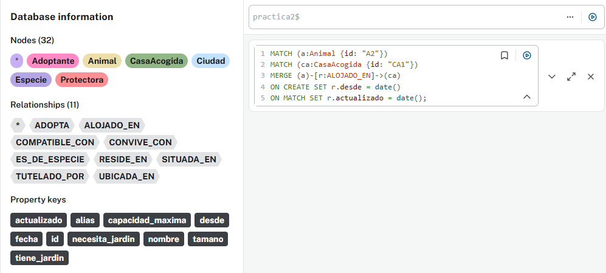

### scripts/03-consultas-operaciones.cypher

```cypher
// 1. Operación básica: Actualizar de forma segura (MERGE + SET)
// Asignamos una nueva casa de acogida a Luna (A2) actualizando su estado.
MATCH (a:Animal {id: "A2"}), (ca:CasaAcogida {id: "CA1"})
MERGE (a)-[r:ALOJADO_EN]->(ca)
ON CREATE SET r.desde = date()
ON MATCH SET r.actualizado = date();

// 2. Consulta de 1 salto: Vecinos inmediatos
// ¿Qué animales están tutelados por "Refugio Patas" y cuál es su especie?
MATCH (a:Animal)-[:TUTELADO_POR]->(p:Protectora {nombre: "Refugio Patas"})
MATCH (a)-[:ES_DE_ESPECIE]->(e:Especie)
RETURN a.nombre AS Animal, a.tamano AS Tamano, e.nombre AS Especie;

// 3. Consulta de varios saltos: Filtrado y encadenamiento
// Buscar casas de acogida en la misma ciudad que los adoptantes que tienen jardín, 
// para posibles visitas de pre-adopción.
MATCH (ad:Adoptante {tiene_jardin: true})-[:RESIDE_EN]->(c:Ciudad)<-[:SITUADA_EN]-(ca:CasaAcogida)
RETURN ad.alias AS Adoptante, c.nombre AS Ciudad, ca.alias AS Casa_Acogida;

// 4. Recomendación por afinidad (MATCH PATTERNS)
// CASO REAL: El Adoptante AD2 vive en Madrid, no tiene jardín y ya convive con un Gato.
// Queremos recomendarle un Perro que esté en Madrid, que no necesite jardín y sea compatible con gatos.
MATCH (ad:Adoptante {id: "AD2"})-[:RESIDE_EN]->(c:Ciudad)
MATCH (ad)-[:CONVIVE_CON]->(especie_residente:Especie)
MATCH (a:Animal {necesita_jardin: false})-[:TUTELADO_POR|:ALOJADO_EN]->(ubicacion)-[:UBICADA_EN|:SITUADA_EN]->(c)
MATCH (a)-[:ES_DE_ESPECIE]->(:Especie {nombre: "Perro"})
MATCH (a)-[:COMPATIBLE_CON]->(especie_residente)
WHERE NOT (a)<-[:ADOPTA]-() // Que no esté adoptado ya
RETURN a.nombre AS Recomendacion_Ideal, a.tamano AS Tamano;

// 5. Camino más corto (shortestPath)
// Calcula el grado de separación entre el Adoptante "AD2" y el perro "Rex" (A4)
MATCH (inicio:Adoptante {id: "AD2"}), (fin:Animal {id: "A4"})
MATCH camino = shortestPath((inicio)-[*]-(fin))
RETURN camino;
```
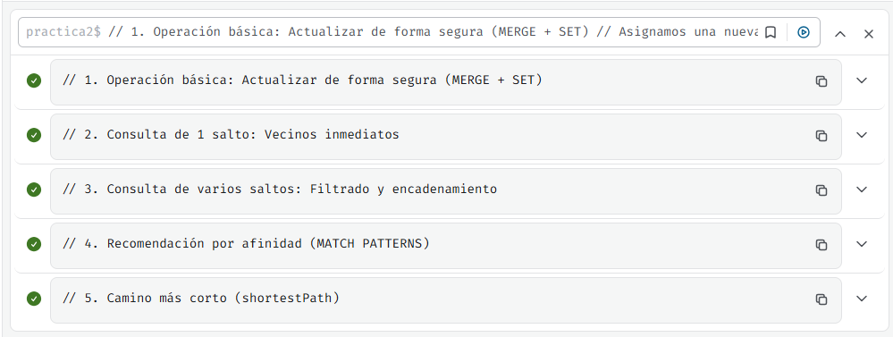

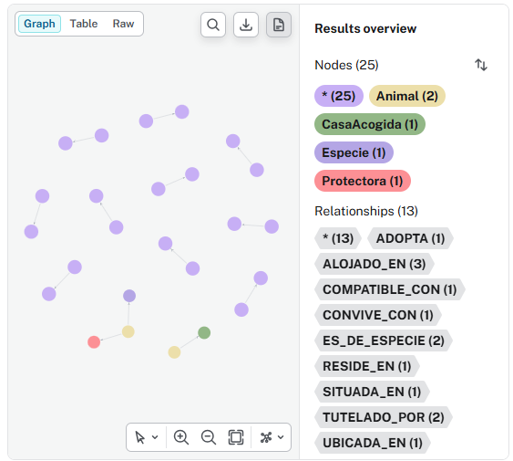

# 5. Comparativa técnica, Seguridad y Copias (Actividad 5)

## 1. Comparativa Técnica frente a SQL
Para responder a la **Consulta 4 (Recomendación por afinidad)** en una base de datos relacional tradicional (PostgreSQL/MySQL), necesitaríamos enlazar las siguientes tablas:
`Adoptantes` JOIN `Ciudades` JOIN `Protectoras_Ubicacion` JOIN `Animales` JOIN `Animal_Especie` JOIN `Compatibilidades` JOIN `Convivencia_Actual`.

**Problema en SQL:** Son unos **6 o 7 JOINs**. A medida que la base de datos crezca (cientos de miles de registros), la base de datos relacional consumirá una cantidad enorme de RAM y CPU cruzando índices B-Tree, calculando productos cartesianos y filtrando en tiempo de ejecución. 
**Ventaja en Neo4j:** Utiliza **Index-Free Adjacency** (Adyacencia libre de índices). Una vez que Neo4j localiza al `Adoptante` y a la `Ciudad` inicial a través de un índice (paso de O(log n)), el resto de saltos son desplazamientos directos en memoria (O(1) por relación). El rendimiento depende del grafo local que se recorre, no del tamaño total de la base de datos.

## 2. Copias de Seguridad y Restauración
Para volcar los datos en un entorno local (Cypher-shell/Terminal):
1. **Detener la base de datos:** `neo4j-admin database stop neo4j`
2. **Generar Backup (Dump):** 
   `neo4j-admin database dump neo4j --to-path=/ruta/backups/neo4j_backup_2026.dump`
3. **Restaurar (Load):** 
   `neo4j-admin database load neo4j --from-path=/ruta/backups/neo4j_backup_2026.dump --overwrite-destination=true`
*(Si se usa Neo4j Aura, el snapshot se programa desde la consola web del Cloud y se exporta gráficamente).*

## 3. Seguridad, Permisos y RGPD
Para proteger datos (RGPD), se establecen roles mínimos con RBAC (Role-Based Access Control):
- **Rol `app_reader`:** Solo tiene permiso de lectura (`GRANT MATCH ON GRAPH neo4j TO app_reader`). Se le asigna a la API de la aplicación móvil de los adoptantes. No ven los nodos `:CasaAcogida` directamente.
- **Rol `shelter_manager`:** Permisos de lectura y escritura (`GRANT WRITE...`), pero limitados a modificar nodos `:Animal` y crear `:Adoptante`.

## 4. Cuándo NO usar Neo4j
Los grafos no sirven para todo. Sería un error utilizar Neo4j en estos dos escenarios:
1. **Sistemas Transaccionales Contables (Ledgers/ERP):** Si necesitamos procesar pagos, facturas de las protectoras y nóminas de veterinarios. Las BBDD relacionales (ACID estricto tabular) son ideales para esto.
2. **Almacenamiento de historiales clínicos completos:** Si queremos guardar el documento completo (PDF, largos textos) de la cartilla sanitaria o historial de operaciones de un perro, es mucho más eficiente usar una Base de Datos Documental como **MongoDB**.